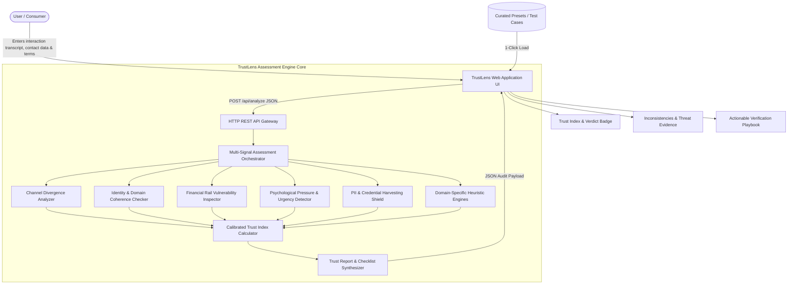
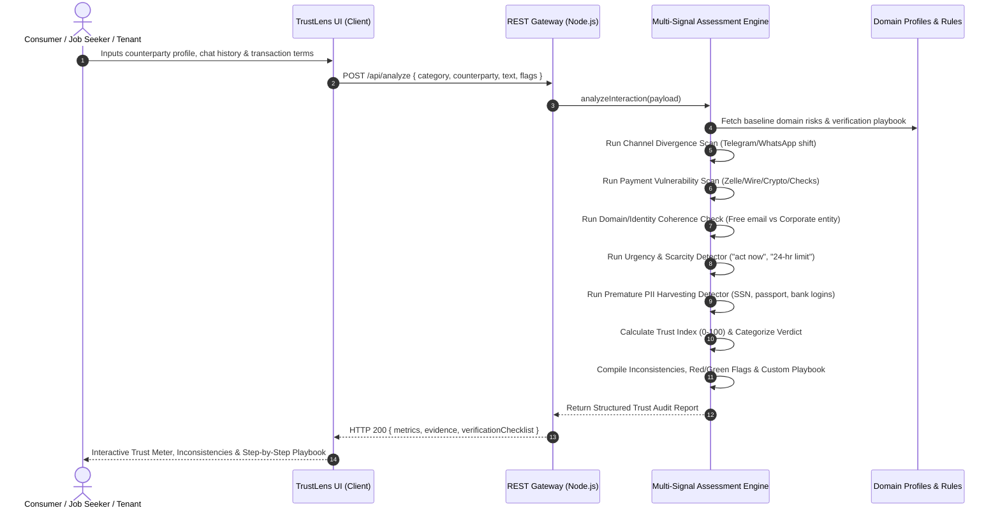

# TrustLens — Technical Design Document (TDD)

## 1. System Overview
**TrustLens** is a full-interaction credibility and deception assessment engine. Unlike conventional security tools that only inspect isolated URLs, domain certificates, or text snippets, TrustLens evaluates the holistic dynamics of an online interaction between a user and an unverified counterparty across four sensitive domains:
1. **Online Marketplace Sellers** (Classifieds, Social eCommerce, P2P sales)
2. **Employment & Job Offers** (Remote roles, unsolicited recruiter outreach, freelancer onboarding)
3. **Rental Listings** (Apartment leases, vacation sublets, roommate agreements)
4. **Service Providers** (Home contractors, freelance developers, tutors, consultants)

---

## 2. System Architecture



---

## 3. Data Flow & Sequential Evaluation Pipeline



---

## 4. Multi-Signal Scoring Methodology & Decision Thresholds

The engine computes a **Trust Index ($T \in [0, 100]$)** from an aggregated risk penalty:

$$T = \max\Big(0, \min\big(100, 100 - \sum \text{Risk Penalties} + \sum \text{Credibility Credits}\big)\Big)$$

### Decision Thresholds:
| Trust Index ($T$) | Verdict Category | Color Indicator | Recommended Action |
|---|---|---|---|
| **80 – 100** | **SAFE** | Green | Standard precautions; counterparty displays verified channels, escrow, and transparency. |
| **60 – 79** | **PROCEED WITH CAUTION** | Yellow | Moderate trust; run recommended verification checklist before making commitments. |
| **35 – 59** | **HIGH RISK** | Orange | Multiple anomalies detected; suspend financial transactions until identity is vetted. |
| **0 – 34** | **FRAUD ALERT** | Red | Severe deception indicators (e.g. check equipment scam, absentee landlord, irreversible wire). **Halt all engagement.** |

---

## 5. Threat Model & Deception Vectors Handled

1. **Channel Migration Trap**: Scammers urgently redirect targets from protected platforms (LinkedIn, Airbnb, Upwork, eBay) to unmonitored encrypted apps (Telegram, WhatsApp) to evade fraud algorithms and eliminate platform buyer protections.
2. **Fake Check / Procurement Fraud**: Fraudulent recruiters send high-value fake cashier checks to job seekers and instruct them to buy hardware from an "approved vendor" before the check bounces.
3. **Absentee Landlord Narrative**: Deceptive rental hosts claim emergency overseas mission assignments and demand upfront deposits via wire/Zelle in exchange for couriering front door keys.
4. **Irreversible Payment Pressure**: Sellers demanding Venmo "Friends & Family", Zelle, cryptocurrency, or gift cards with no dispute or chargeback rights.
5. **Premature PII Harvesting**: Unsolicited collection of government identity numbers (SSN, National ID), credit checks via spoofed links, or two-factor authentication codes.

---

## 6. API Contract

### `POST /api/analyze`
**Request Payload:**
```json
{
  "category": "job",
  "counterpartyName": "Sarah Jenkins",
  "claimedEntity": "Deloitte Global",
  "platform": "LinkedIn InMail",
  "contactInfo": "sarah.jenkins.deloitte@gmail.com",
  "paymentMethod": "Cashier check for equipment purchase",
  "pricingDetails": "$75/hr data entry",
  "conversationText": "Interview on Telegram @sarah_rec...",
  "requestedPii": ["SSN", "Driver license photo"],
  "interactionFlags": {
    "offPlatformUrged": true,
    "irreversiblePayment": true,
    "highUrgency": true,
    "checkEquipment": true
  }
}
```

**Response Payload:**
```json
{
  "category": "job",
  "scenarioName": "Job Offer / Remote Employment",
  "counterpartyName": "Sarah Jenkins",
  "evaluatedAt": "2026-10-08T20:30:00.000Z",
  "metrics": {
    "trustIndex": 0,
    "riskScore": 100,
    "verdict": "FRAUD ALERT",
    "verdictColor": "red",
    "summaryHeading": "Severe Deception Indicators Detected",
    "summaryText": "High probability of deceptive counterparty or scam pattern..."
  },
  "evidence": {
    "inconsistencies": [
      {
        "claim": "Represents corporate entity 'Deloitte Global'...",
        "conflict": "Authentic enterprise recruiters use company domain emails..."
      }
    ],
    "redFlags": [...],
    "greenFlags": [...],
    "suspiciousClaims": [...]
  },
  "verificationChecklist": [
    "SECURITY ALERT: Withhold all SSN and banking credentials...",
    "HALT: Do not proceed with the requested payment method...",
    "Cross-check recruiter's identity on official corporate job board..."
  ]
}
```
